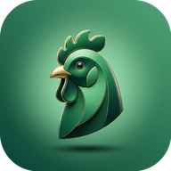

# Poultry Farm Manager (مدیریت طیور)

A native Android app for poultry farmers: day-to-day flock management, a veterinary and husbandry guide, farm finances, and an offline voice assistant that understands spoken Persian. The interface is in Persian (right-to-left).

I designed and built it on my own: around 108,000 lines of Kotlin with Jetpack Compose.

## Features

**Farm management**
- Flocks across multiple houses, with mortality, survival rate, transfers, sales and slaughter
- Daily feed and water logging with live consumption tracking and alerts
- Egg production tracking against laying benchmarks
- Warehouse stock (feed, medicine, equipment), a farm calendar with reminders, and contacts
- Income and expense records with financial reports
- Feed ration builder

**Guide and decision tools**
- Disease catalogue with **76 diseases**, symptom-based diagnosis and medication details
- Breeding and husbandry guide for chickens (broiler, layer, native), turkeys, ducks, geese, quail, guinea fowl and more
- Age-based temperature targets, lighting programmes from local sunrise and sunset times, and seasonal biosecurity advice
- Simulators: investment feasibility and best slaughter day
- Weather for the farm's location (Open-Meteo)
- Two breeding games for learning genetics in a playful way

**Offline voice assistant**
- Speak commands such as "log 3 cartons of eggs for house 2" or "how much feed is left?" in Persian or English
- Runs fully on the device: text normalisation, Persian number and Jalali date parsing, unit conversion (cartons, sacks, kg), intent scoring and multi-turn dialogue
- Asks for missing details, confirms before changing data, and can undo
- Writes only through the app's repositories, so the same business rules apply as in the UI

**Platform**
- Three home-screen widgets: farm status, quick actions and voice assistant
- Exact alarms and notifications that survive a reboot
- Full backup and restore, plus encrypted multi-device sync (AES-GCM, PBKDF2 key derivation, last-write-wins merge)
- Light, dark and system themes

## Tech stack

| Area | Tools |
|---|---|
| Language | Kotlin 2.3 |
| UI | Jetpack Compose, Material 3, Navigation 3 |
| Data | SQLite (`SQLiteOpenHelper`) with repositories and manual dependency injection |
| Background | AlarmManager, BroadcastReceivers, App Widgets |
| Security | `javax.crypto` AES-GCM with PBKDF2-HMAC-SHA256 |
| Testing | JUnit 4 and kotlinx-coroutines-test (89 unit tests) |
| Build | Gradle (Kotlin DSL), version catalog, R8 shrinking for release |

Min SDK 26 (Android 8.0), target SDK 35.

## Project structure

```text
app/src/main/java/com/example/poultryapp/
  ui/          Compose screens (flocks, feed and water, health, finance, warehouse, guide, simulators, games)
  data/        SQLite database, entities, repositories, backup and sync
  engine/      domain logic: nutrition, temperature, disease diagnosis, slaughter and investment maths, daylight
  assistant/   offline voice assistant: normalisation, entity parsing, intent scoring, dialogue, actions
  receiver/    alarms, boot handling, live feed and water notifications
  widget/      home-screen widgets
  security/    encryption for backups and sync
app/src/test/  unit tests
```

## Build and run

Open the project in Android Studio, or from the command line (JDK 17):

```bash
./gradlew assembleDebug        # app/build/outputs/apk/debug/app-debug.apk
./gradlew testDebugUnitTest    # unit tests
```

Release builds read signing details from a local `keystore.properties` file, which is not included in this repository.

## Author

Built by **Ali Hosseini**, full-stack and Android developer. [LinkedIn](https://www.linkedin.com/in/ali-hosseini-dev/) · [GitHub](https://github.com/Ali-Black-Eagle)
